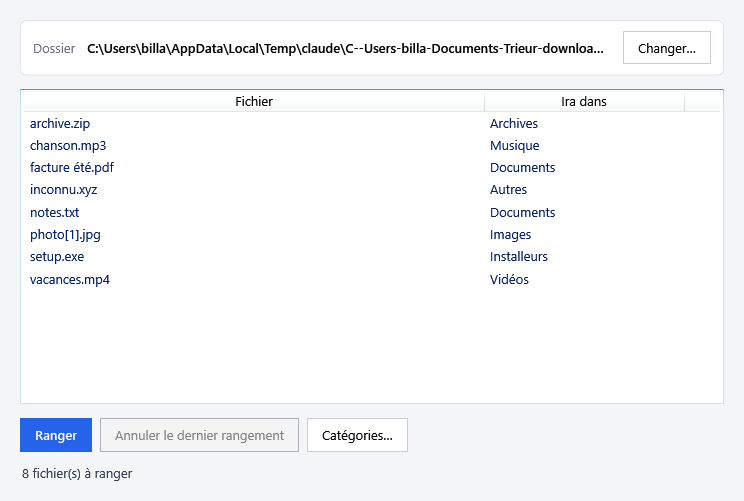
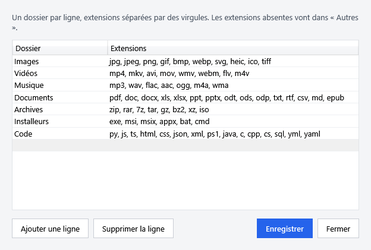

# Rangeur de Téléchargements

Petite application Windows qui range le dossier Téléchargements en un clic : chaque fichier part dans un sous-dossier selon son type (Images, Vidéos, Musique, Documents, Archives, Installeurs, Code, Autres).



## Ce qu'elle fait

- **Aperçu** : la liste des fichiers et du dossier où chacun ira, avant de ranger quoi que ce soit.
- **Ranger** : déplace les fichiers et affiche un résumé.
- **Annuler le dernier rangement** : remet les fichiers à leur place.
- **Catégories…** : ajoute ou modifie des dossiers et leurs extensions, sans toucher au code.
- **Changer…** : range un autre dossier que Téléchargements.



## Sécurité de tes fichiers

- Rien n'est jamais supprimé ni écrasé : en cas de nom déjà pris, le fichier devient `nom (2).ext`.
- Les sous-dossiers existants ne sont pas touchés.
- Les téléchargements en cours (`.crdownload`, `.part`…) et les fichiers cachés restent en place.
- Chaque déplacement est noté dans `rangement.log`, dans le dossier rangé.

## Installation

1. Télécharge `Rangeur.exe` depuis la page [Releases](../../releases/latest).
2. Lance-le. Le fichier n'est pas signé : Windows SmartScreen peut afficher « Windows a protégé votre ordinateur ». Clique sur **Informations complémentaires**, puis **Exécuter quand même**.

Le programme copie ses scripts dans `%LOCALAPPDATA%\Rangeur` et ouvre la fenêtre. Tes catégories personnalisées y sont gardées (`categories.json`) et ne sont jamais écrasées par une nouvelle version.

Configuration requise : Windows 10 ou 11 (PowerShell 5.1 et .NET Framework 4, présents par défaut).

## Pour les développeurs

Le code est en PowerShell 5.1 avec une interface WPF :

- `src/Ranger-Telechargements.ps1` : toute la logique (catégories, aperçu, rangement, annulation) ; utilisable seul pour un rangement sans fenêtre.
- `src/Rangeur-UI.ps1`, `src/Fenetre.xaml`, `src/Categories.xaml` : l'interface.
- `build/Lanceur.cs` et `build/Construire-Exe.ps1` : le lanceur `.exe`.

Lancer les tests (Pester 3.4, fourni avec Windows) :

```powershell
powershell -NoProfile -Command "Invoke-Pester -Script .\tests"
```

Construire l'exécutable dans `dist\Rangeur.exe` (utilise le compilateur C# fourni avec Windows) :

```powershell
powershell -NoProfile -ExecutionPolicy Bypass -File .\build\Construire-Exe.ps1
```

Les choix de conception sont décrits dans `docs/superpowers/specs/`.
